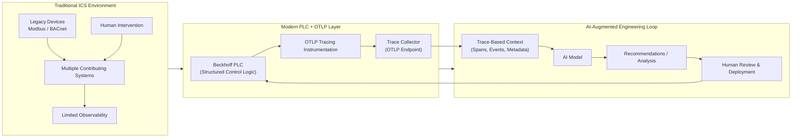

# TcOtlp

OpenTelemetry logs and traces for Beckhoff TwinCAT 3 PLCs, written from scratch in Structured Text.

TcOtlp lets a PLC program emit OpenTelemetry log records and spans, correlate them with each other, carry trace context across PLCs, and export them over OTLP/HTTP (ProtoJSON) to any OpenTelemetry collector or backend, such as SigNoz. The API is built to feel natural to PLC programmers: fluent builder chains, one-line failure handling, explicit memory ownership, and bounded work every scan.

> **Status:** pre-release (`0.0.0.1`). Logging and tracing are implemented and tested; metrics are not started. The API may still change.

## Rationale

Over the last 18 months AI has become prolific in the programming industry. Most of the improvements are not due to the performance of the models, although those are continuing to improve, but to tooling that creates effective feedback loops for AI.

Industrial control systems, even "modern" ones (I'm looking at you Modbus and BACnet systems), are a mess when it comes to observability, clear cause and effect between controls and process outputs, and programming best practices in general, which makes AI integration difficult if not impossible.

Compounding this, many systems often contribute to a single process, and conveying the system architecture to AI may not be possible, especially for systems that require frequent human intervention, which is hard to capture and distill into a "signal" for AI.

I believe the solution is to use the OpenTelemetry standards on modern PLC platforms such as Beckhoff, so that PLC programmers can "tell the story" to AI in small, digestible chunks using open standards AI is already trained on.

An example architecture demonstrating the concept:



The benefits of a loop like this could be large. Instead of diagnosing the acute cause of a failure or digging through SCADA-level logs, operators could ask an AI agent what caused the issue, and eventually, for common-cause failures, AI could step in and resolve them automatically.

### Why implement OTLP from scratch in Structured Text

- Full control over how the spec is implemented.
- A chance to make the API obvious to hold for PLC programmers, for example by making fields such as `service.name` part of normal setup.
- Deterministic, bounded cyclic execution and explicit memory ownership, which generic code generated from the `.proto` files did not give.

The trade-off is that only OTLP/HTTP is supported. gRPC needs HTTP/2, which the PLC does not provide.

## Features

**Logging**

- `FB_LoggerProvider`, `FB_Logger` and `FB_LogRecord`, following the OpenTelemetry log data model
- Fluent record building with severity, body, event name, string and number attributes, and timestamps
- Log–trace correlation with `setTraceContextFromSpan`
- Simple and batch log record processors
- Console, file and HTTP log record exporters

**Tracing**

- `FB_TracerProvider`, `FB_Tracer` and `FB_Span`, with span kinds, attributes, links and status
- Parent spans from a local span or from a remote `FB_SpanContext`
- W3C Trace Context propagation (`traceparent` and `tracestate`) through `TraceContextPropagator.inject` / `extract`
- Trace and span ID generation with `FB_IdGenerator`
- `FB_Sampler_AlwaysOn` and `FB_Sampler_ErrorsOnly` samplers
- Simple and batch span processors
- Console, file and HTTP span exporters

**Shared**

- Owned OTLP values (`FB_AnyValue`, `FB_String`, `FB_Number`, `FB_KeyValue`, …) created through `ValueFactory`
- `FB_Resource` and `FB_InstrumentationScope`, snapshotted into every record and span
- ProtoJSON serialization that groups records and spans by resource and scope to keep payloads small
- Explicit limits on attributes, links, records per scan and loop iterations (`TcOtlp_GVL`)

## Quick start

TcOtlp is consumed as a TwinCAT library (`bin/otel.library`, title `TcOtlp`). Add it to your PLC project's references, then set up a provider, a processor and an exporter, and tick the providers every scan.

```iec
// GVL
VAR_GLOBAL
	resource: FB_Resource(schemaUrl := '');
	loggerProvider: FB_LoggerProvider(resource := resource);

	sampler: FB_Sampler_AlwaysOn();
	idGenerator: FB_IdGenerator(nTraceIds := 5, nSpanIds := 5);
	tracerProvider: FB_TracerProvider(resource := resource, idGenerator := idGenerator, sampler := sampler);
END_VAR
```

```iec
PROGRAM MAIN
VAR
	scope: FB_InstrumentationScope(name := 'pumpskid', version := '1.0.0', schemaUrl := '');

	logger: FB_Logger(scope := scope, provider := GVL.loggerProvider);
	logExporter: FB_LogRecordExporter_HTTP('http://192.168.1.10:4318/v1/logs');
	logProcessor: FB_LogRecordProcessor_Batch(maxQueueSize := 500, scheduledDelayMillis := 1500,
	                                          maxExportBatchSize := 500, exporter := logExporter);

	tracer: FB_Tracer(scope := scope, provider := GVL.tracerProvider);
	spanExporter: FB_SpanExporter_HTTP('http://192.168.1.10:4318/v1/traces');
	spanProcessor: FB_SpanProcessor_Batch(maxQueueSize := 500, scheduledDelayMillis := 1500,
	                                      maxExportBatchSize := 500, exporter := spanExporter);

	firstScan: BOOL := TRUE;
	pSpan: POINTER TO FB_Span;
END_VAR

IF firstScan THEN
	GVL.resource.attributes.setStringAttribute('service.name', 'pumpskid1');
	firstScan := FALSE;
END_IF

// run the pipelines every scan
GVL.loggerProvider.stageProcessor(logProcessor).tick();
GVL.tracerProvider.stageProcessor(spanProcessor).tick();

// start a span; the tracer hands it to you
tracer
	.startSpan('pump.start')
	.setNumberAttribute('flow.setpoint', 700)
	.build(pSpan);

// log inside it
logger
	.startLogRecord(E_SeverityNumber.INFO)
	.setBody('starting pump')
	.setTraceContextFromSpan(pSpan)
	.emit();

// later, when the work is done
tracer.setSpanStatusOk(pSpan);
tracer.endSpan(pSpan);  // hands the span to the provider and clears pSpan
```

Every setter returns the builder, and failures are deferred: the first failure in a chain is reported by `emit` / `build`, and the incomplete record or span is released. Check the result with `IF NOT logger....emit(failureResult => reason) THEN`.

For the full API, lifecycle and ownership rules of each block, see the model notes in [`docs/obsidian/models/`](docs/obsidian/models/).

## Architecture

Log data flows through five domains. Tracing mirrors the same shape with spans.

```text
Value Creation -> Log Creation -> Log Processing -> Log Serialization -> Log Exporting
```

| Domain | Responsibility | Location |
| --- | --- | --- |
| Value Creation | Create, clone and release OTLP values | `OTEL/VALUES/` |
| Log Creation | Providers, loggers, records, resource and scope | `OTEL/LOGGING/`, `OTEL/COMMON/` (resource and scope) |
| Log Processing | Queues, batching, enrichment, drop policy | `OTEL/LOGGING/PROCESSORS/` |
| Log Serialization | OTLP ProtoJSON wire format | `OTEL/SERIALIZATION/`, `OTEL/LOGGING/SERIALIZATION/` |
| Log Exporting | Console, file and HTTP delivery | `OTEL/EXPORTING/`, `OTEL/LOGGING/EXPORTING/` |
| Tracing | Tracer, spans, context, propagation, sampling, processing, export | `OTEL/TRACING/` |

Design rules that hold across the library:

- **Explicit ownership.** A callee owns a pointer only when its contract says so, and then the caller's pointer is cleared. Every allocation is released exactly once.
- **Bounded scans.** Every loop has a limit, and destination I/O runs as a state machine across scan cycles.
- **Processors own policy, exporters own I/O.** A processor never calls `export` on a busy exporter; a simple processor drops, a batch processor keeps the item queued.
- **Single task.** Each block assumes it is created, called and released from one PLC task. Multi-task safety is a non-goal.

[`CLAUDE.md`](CLAUDE.md) holds the full domain model and cross-domain rules.

## Simulations

`Simulations/` is a separate TwinCAT solution that exercises the library end to end with a chiller lineup:

- **`master`** runs lead/lag/standby staging across three pump skids. Each staging sequence is a span, and each skid command carries the span's context to the skid over ADS.
- **`ps1`, `ps2`, `ps3`** are the pump skids. Each extracts the master's context, traces its startup or shutdown steps (pump, valve, Modbus, chiller) as child spans, emits correlated logs, and can simulate faults.

The result is a single distributed trace spanning four PLCs. The simulations export to an OTLP/HTTP endpoint; change the URLs in each `MAIN` to point at your collector.

## Repository layout

| Path | Contents |
| --- | --- |
| `TcOtlp/otel/` | The library PLC project |
| `TcOtlp/test/` | TcUnit test project, with suites mirroring the library domains |
| `Simulations/` | Chiller lineup simulation solution |
| `bin/otel.library` | Compiled library |
| `docs/obsidian/` | Design notes, model docs, diagrams and user stories (an Obsidian vault) |
| `tools/` | PowerShell automation for building, testing and reading Visual Studio output |
| `.claude/skills/` | Agent skills for running and writing tests, design review and issue handling |
| `ROADMAP.md` | What comes next |

## Development

### Setup

1. Install Git.
2. Install Visual Studio 2022 (used for scripted builds by coding agents) and the Beckhoff Package Manager.
3. Install TwinCAT XAE and TcUnit.
4. Set up an OTLP/HTTP collector for integration testing, for example SigNoz (see the SigNoz docs).
5. Open `TcOtlp/TcOtlp.sln` in TcXaeShell.

### Running the tests

The test project references the installed `TcOtlp` library, not the library sources, so install the library before testing library changes:

```powershell
./tools/run-tests.ps1 -InstallLibrary
```

The script attaches to the running TcXaeShell, reloads the solution, builds, activates TwinCAT, and reads the TcUnit results from the output pane into `tools/test-results.log`.

### Working with coding agents

The repository is set up for AI-assisted development. `CLAUDE.md` describes the domain model and rules, and the skills in `.claude/skills/` let an agent run tests (`running-tests`), write TcUnit suites (`writing-tests`), read the TwinCAT output window (`reading-output-window`), review code against the design checks (`design-review`) and work through `ISSUE` comments in the source (`handle-issues`).

## Roadmap

See [`ROADMAP.md`](ROADMAP.md). Next steps include control endpoints for Ignition over OPC UA that accept an optional trace context, and monitoring a real, non-critical process.

Known gaps:

- Metrics are not implemented.
- OTLP/HTTP with ProtoJSON only; no gRPC or binary protobuf.
- Batch processors have no `forceFlush`, so items still queued when the PLC stops are lost.
- Span processors are notified only when a span ends, not when it starts.
