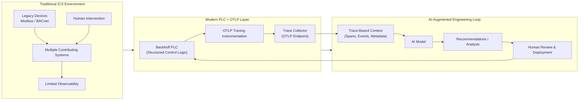

# TcOtlp
Project used to help implement the OTLP tracing and logging standards for Beckhoff PLCs.

# Rational
Over the last 18 months AI has become prolific in the programming industry, however, most of the improvements are not due to improvements
in the performance of the models, although those are continuing to improve, but rather in tooling that creates effective feedback loops for AI.  

Industrial control systems, even "modern" ones (I'm looking at you Modbus and Bacnet systems) are a poop show when it comes to observability, 
clear cause and effects between controls and process outputs, and programming best practices in general, making AI integrations difficult if not impossible.

Compounding this is the fact that many systems often contribute to a single process and conveying the system architecture to AI may not be possible,
especially for systems that require frequent human intervention which can be hard to capture and distill into a "signal" for AI.

I believe the solution to this problem is to use the OTLP tracing standards on top of modern PLC platforms such as Beckhoff PLCs to enable
PLC programmers to "tell the story" to AI in small digestible chunks using open standards that AI is already trained for.

An example architecture demonstrating the concept:

The benefits that a loop such as this could provide would be rather large, for example, instead of diagnosing the acute cause of a failure or looking through SCADA level logs,
operators could simply ask an AI agent what was causing the issue, and eventually for common cause failures, AI could step in and resolve the issues automatically.

# Implementation Method

# Implement OLTP from Scratch Using Structured Text

# Advantages
- Will provide full control over how we implement the spec.
- Will give an opportunity to maximize ergonomics. 

### Disadvantages
- Does not support GRPC as PLC's don't implement HTTP2.

# Development Environment Setup
1. Install git
2. Install Visual Studio Community 2022 (For coding agent build ability)
3. Install Beckhoff Package Manager
4. Install the XAE Programming Environment
5. Install TcUnit inside of said environment
6. Setup Signoz for Integration Tests (see signoz docs for details)
7. Begin programming 

